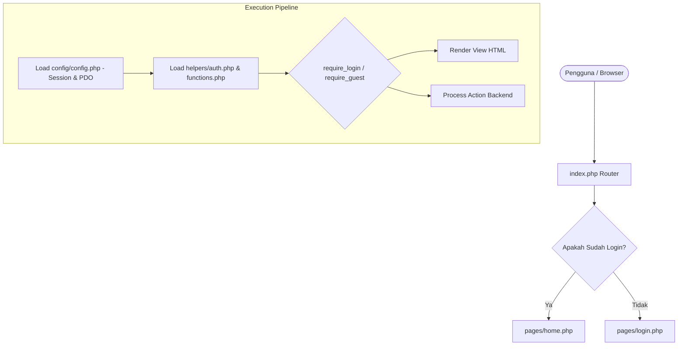
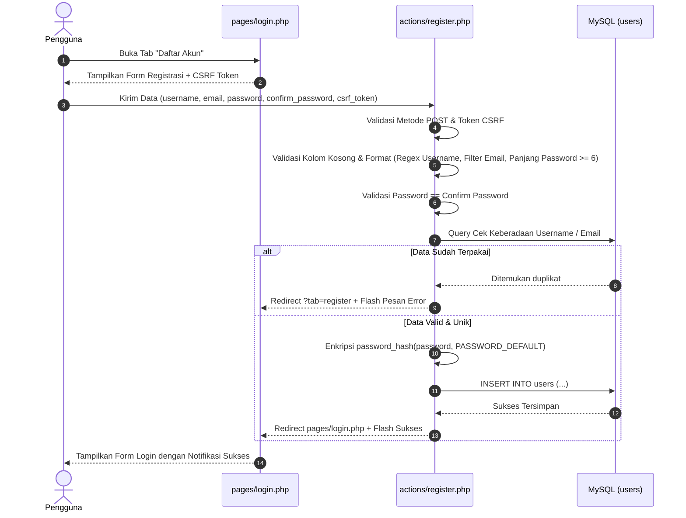
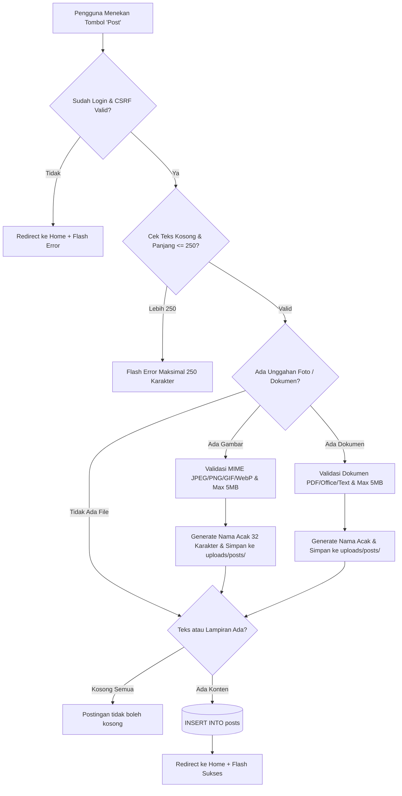
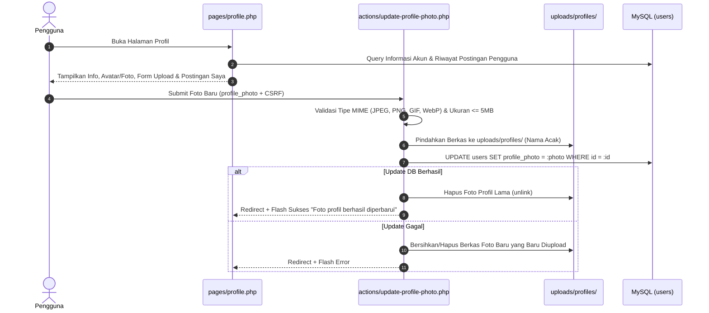

# DOKUMENTASI LENGKAP FITUR, ALUR, DAN CARA KERJA SISTEM CONNE

Dokumen ini menjelaskan secara menyeluruh tentang arsitektur, basis data, alur kerja (*flow*), serta cara kerja teknis dari seluruh fitur yang ada pada aplikasi web **CONNE**.

---

## DAFTAR ISI
1. [Gambaran Umum Proyek](#1-gambaran-umum-proyek)
2. [Struktur Direktori & Arsitektur Aplikasi](#2-struktur-direktori--arsitektur-aplikasi)
3. [Skema Basis Data (Database Schema)](#3-skema-basis-data-database-schema)
4. [Siklus Hidup Request (Request Lifecycle)](#4-siklus-hidup-request-request-lifecycle)
5. [Alur & Cara Kerja Fitur Autentikasi (Register, Login, Logout)](#5-alur--cara-kerja-fitur-autentikasi)
6. [Alur & Cara Kerja Fitur Postingan (CRUD Post)](#6-alur--cara-kerja-fitur-postingan)
7. [Alur & Cara Kerja Fitur Komentar (CRUD Comment)](#7-alur--cara-kerja-fitur-komentar)
8. [Alur & Cara Kerja Fitur Pencarian / Filter Hashtag](#8-alur--cara-kerja-fitur-pencarian--filter-hashtag)
9. [Alur & Cara Kerja Fitur Profil & Perubahan Foto Profil](#9-alur--cara-kerja-fitur-profil--perubahan-foto-profil)
10. [Mekanisme Keamanan Sistem (Security Measures)](#10-mekanisme-keamanan-sistem)

---

## 1. GAMBARAN UMUM PROYEK

**CONNE** adalah platform jejaring sosial berbasis web (*microblogging*) yang terinspirasi dari antarmuka modern (gaya Twitter/X). Aplikasi ini memungkinkan pengguna untuk:
- Mendaftar dan masuk ke akun dengan aman.
- Membagikan postingan (status teks hingga 250 karakter, gambar, dan dokumen lampiran).
- Berinteraksi melalui komentar yang juga mendukung lampiran media/file.
- Mencari topik tertentu menggunakan tagar/hashtag (`#`).
- Mengelola profil pribadi serta mengganti foto profil.

Aplikasi dibangun menggunakan **PHP Native** berorientasi keamanan dan modularitas, didukung oleh **MySQL (PDO)** untuk manipulasi data transaksi serta **CSS Kustom** responsif.

---

## 2. STRUKTUR DIREKTORI & ARSITEKTUR APLIKASI

Aplikasi CONNE menerapkan pemisahan tanggung jawab (*Separation of Concerns*) antara logika bisnis/proses (*actions*), tampilan antarmuka (*pages*), utilitas bersama (*helpers*), dan konfigurasi (*config*):

```
conne/
│
├── index.php                      # Main Router & Entry Point
├── database.sql                   # Skrip DDL Basis Data
├── DOKUMENTASI_FITUR.md           # Dokumentasi resmi sistem
│
├── actions/                       # Controller pemrosesan POST (Backend Action)
│   ├── login.php                  # Proses verifikasi login
│   ├── logout.php                 # Proses destroy session
│   ├── register.php               # Proses registrasi pengguna baru
│   ├── store-post.php             # Proses penyimpanan postingan baru
│   ├── update-post.php            # Proses perubahan postingan
│   ├── delete-post.php            # Proses penghapusan postingan & relasinya
│   ├── store-comment.php          # Proses penambahan komentar
│   ├── update-comment.php         # Proses perubahan komentar
│   ├── delete-comment.php         # Proses penghapusan komentar
│   └── update-profile-photo.php   # Proses upload & ganti foto profil
│
├── assets/                        # Berkas statis publik
│   └── css/
│       └── style.css              # Seluruh aturan desain antarmuka
│
├── config/                        # Konfigurasi sistem
│   └── config.php                 # Koneksi PDO MySQL & inisialisasi session
│
├── helpers/                       # Fungsi-fungsi pembantu (Utilities)
│   ├── auth.php                   # Middleware login/guest & session auth
│   └── functions.php              # Sanitasi XSS, CSRF, flash message, file uploader
│
├── includes/                      # Komponen antarmuka yang dapat dipakai ulang
│   └── navbar.php                 # Navigasi atas (Logo, Home, Profil, Logout)
│
├── pages/                         # Tampilan antarmuka pengguna (Views)
│   ├── login.php                  # Halaman Login & Registrasi (Tab ganda)
│   ├── register.php               # Pengalihan (redirect) ke tab pendaftaran
│   ├── home.php                   # Beranda, timeline postingan & form status
│   ├── detail-post.php            # Halaman detail postingan & daftar komentar
│   ├── edit-post.php              # Form edit postingan
│   ├── edit-comment.php           # Form edit komentar
│   └── profile.php                # Halaman profil & riwayat postingan pengguna
│
└── uploads/                       # Direktori penyimpanan berkas unggahan
    ├── .htaccess                  # Proteksi eksekusi skrip di folder berkas
    ├── profiles/                  # Berkas foto profil pengguna
    ├── posts/                     # Gambar dan dokumen lampiran postingan
    └── comments/                  # Gambar dan dokumen lampiran komentar
```

---

## 3. SKEMA BASIS DATA (DATABASE SCHEMA)

Aplikasi menggunakan basis data bernama `db_conne` dengan 3 tabel utama yang saling terhubung:

### A. Tabel `users`
Menyimpan akun dan identitas pengguna.
| Kolom | Tipe Data | Atribut | Keterangan |
|---|---|---|---|
| `id` | INT | PRIMARY KEY, AUTO_INCREMENT | ID unik pengguna |
| `username` | VARCHAR(50) | NOT NULL, UNIQUE | Username akun unik (alfanumerik + `_`) |
| `email` | VARCHAR(100) | NOT NULL, UNIQUE | Alamat surel aktif |
| `password` | VARCHAR(255) | NOT NULL | Password terenkripsi (*bcrypt hash*) |
| `bio` | TEXT | NULL | Deskripsi singkat pengguna |
| `profile_photo` | VARCHAR(255) | NULL | Lokasi relatif berkas foto profil |
| `created_at` | TIMESTAMP | DEFAULT CURRENT_TIMESTAMP | Waktu akun terdaftar |
| `updated_at` | TIMESTAMP | DEFAULT CURRENT_TIMESTAMP ON UPDATE | Waktu perubahan terakhir |

### B. Tabel `posts`
Menyimpan konten status atau postingan utama pengguna.
| Kolom | Tipe Data | Atribut | Keterangan |
|---|---|---|---|
| `id` | INT | PRIMARY KEY, AUTO_INCREMENT | ID unik postingan |
| `user_id` | INT | NOT NULL, FOREIGN KEY (`users.id`) | ID pemilik postingan |
| `content` | VARCHAR(250) / TEXT | NOT NULL | Isi teks status (maks. 250 karakter) |
| `image` | VARCHAR(255) | NULL | Path relatif gambar jika ada |
| `file` | VARCHAR(255) | NULL | Path relatif dokumen lampiran jika ada |
| `file_name` | VARCHAR(255) | NULL | Nama asli dokumen saat diunggah |
| `created_at` | TIMESTAMP | DEFAULT CURRENT_TIMESTAMP | Waktu publikasi postingan |
| `updated_at` | TIMESTAMP | DEFAULT CURRENT_TIMESTAMP ON UPDATE | Waktu edit postingan |

### C. Tabel `comments`
Menyimpan balasan/komentar pengguna pada suatu postingan.
| Kolom | Tipe Data | Atribut | Keterangan |
|---|---|---|---|
| `id` | INT | PRIMARY KEY, AUTO_INCREMENT | ID unik komentar |
| `post_id` | INT | NOT NULL, FOREIGN KEY (`posts.id`) | Relasi ke postingan induk |
| `user_id` | INT | NOT NULL, FOREIGN KEY (`users.id`) | ID pembuat komentar |
| `content` | VARCHAR(250) / TEXT | NOT NULL | Isi teks komentar |
| `image` | VARCHAR(255) | NULL | Path relatif gambar komentar |
| `file` | VARCHAR(255) | NULL | Path relatif dokumen lampiran komentar |
| `file_name` | VARCHAR(255) | NULL | Nama asli dokumen lampiran |
| `created_at` | TIMESTAMP | DEFAULT CURRENT_TIMESTAMP | Waktu pengiriman komentar |
| `updated_at` | TIMESTAMP | DEFAULT CURRENT_TIMESTAMP ON UPDATE | Waktu edit komentar |

---

## 4. SIKLUS HIDUP REQUEST (REQUEST LIFECYCLE)

Setiap permintaan yang masuk ke aplikasi CONNE melalui alur baku berikut:



1. **Inisialisasi (`config.php`)**:
   - Menetapkan konstanta basis data dan path absolut (`BASE_PATH`, `BASE_URL`).
   - Mengatur zona waktu ke `Asia/Jakarta`.
   - Mengatur parameter session cookie yang aman (`HttpOnly`, `SameSite=Lax`).
   - Menginisialisasi koneksi objek PDO dengan *error mode exception* dan *emulated prepares disabled*.
2. **Pemuatan Modul Pembantu (`helpers/`)**:
   - `auth.php` menyediakan fungsi status session (`is_logged_in()`, `current_user_id()`) serta *guard* (`require_login()`, `require_guest()`).
   - `functions.php` menyediakan utilitas pencegah celah keamanan: fungsi `e()` (XSS escaper), `csrf_token()` dan `verify_csrf_token()`, `set_flash()` dan `get_flash()`, serta pengelola upload aman `upload_file()`.
3. **Penyaringan Hak Akses (Guard)**:
   - Jika pengguna belum login mencoba membuka halaman privat (`home.php`, `detail-post.php`, `profile.php`, dll.), sistem otomatis mengalihkan ke `login.php`.
   - Jika pengguna yang sudah login mengakses halaman login/register, sistem mengalihkan mereka ke `home.php`.

---

## 5. ALUR & CARA KERJA FITUR AUTENTIKASI

Modul autentikasi bertanggung jawab mengelola pembuatan identitas akun baru, verifikasi kredensial login, dan pemutusan sesi login.

### A. Alur Registrasi Akun Baru
Halaman: [`pages/login.php?tab=register`](file:///d:/laragon/www/conne/pages/login.php)  
Pemroses: [`actions/register.php`](file:///d:/laragon/www/conne/actions/register.php)



**Detail Mekanisme Validasi Pendaftaran**:
1. **CSRF Check**: `verify_csrf_token()` memastikan form berasal dari formulir sah aplikasi.
2. **Username Sanitasi & Format**: Memeriksa panjang antara 3–50 karakter dan mencocokkan ekspresi reguler `/^[a-zA-Z0-9_]{3,50}$/`.
3. **Format Email**: Menggunakan fungsi bawaan `filter_var($email, FILTER_VALIDATE_EMAIL)`.
4. **Keamanan Password**: Menguji `mb_strlen($password) >= 6` dan kecocokan identik dengan `confirm_password`.
5. **Pencegahan Akun Duplikat**: Mengeksekusi prepared statement `SELECT id FROM users WHERE username = :username OR email = :email LIMIT 1`. Jika duplikat, sistem memberi pesan spesifik apakah *username* atau *email* yang telah terdaftar.
6. **Enkripsi**: Password diamankan menggunakan algoritma hash modern standar PHP (`password_hash()`) sebelum disimpan ke database.

---

### B. Alur Login Pengguna
Halaman: [`pages/login.php`](file:///d:/laragon/www/conne/pages/login.php)  
Pemroses: [`actions/login.php`](file:///d:/laragon/www/conne/actions/login.php)

1. Pengguna memasukkan `email` dan `password`.
2. `actions/login.php` menerima request via metode `POST` dan memvalidasi `csrf_token`.
3. Sistem mencari baris data akun pengguna di tabel `users` berdasarkan alamat email (`LIMIT 1`).
4. **Verifikasi Hash**: Memanggil `password_verify($password, $user['password'])`.
   - Jika akun tidak ditemukan atau verifikasi password gagal, kirim pesan error *"Email atau password salah."* lalu redirect kembali ke halaman login.
   - Jika cocok:
     - Jalankan `session_regenerate_id(true)` untuk mencegah serangan *Session Fixation*.
     - Simpan data sesi pengguna: `$_SESSION['user_id']`, `$_SESSION['username']`, dan `$_SESSION['email']`.
     - Buat token CSRF baru di sesi.
     - Simpan flash message berhasil dan arahkan ke `pages/home.php`.

---

### C. Alur Logout Pengguna
Pemroses: [`actions/logout.php`](file:///d:/laragon/www/conne/actions/logout.php)

1. Form tombol logout di navbar mengirim permintaan `POST` berisi token CSRF.
2. `actions/logout.php` memverifikasi token CSRF.
3. Mengosongkan data sesi dengan `$_SESSION = []`.
4. Menghapus cookie session pengguna di browser (`session_get_cookie_params()`).
5. Memanggil `session_destroy()` untuk memusnahkan data sesi di server.
6. Mengalihkan pengguna kembali ke halaman utama `index.php` (yang mengarahkan ke halaman login).

---

## 6. ALUR & CARA KERJA FITUR POSTINGAN (CRUD POST)

Postingan adalah entitas utama interaksi di CONNE. Pengguna dapat menulis teks singkat dan melampirkan media.

### A. Membuat Postingan Baru (Create)
Halaman: [`pages/home.php`](file:///d:/laragon/www/conne/pages/home.php)  
Pemroses: [`actions/store-post.php`](file:///d:/laragon/www/conne/actions/store-post.php)



**Spesifikasi Teknis Unggahan Berkas**:
- **Format Gambar**: JPEG, JPG, PNG, GIF, WebP (maksimal 5 MB).
- **Format Dokumen**: PDF, TXT, CSV, DOC, DOCX, XLS, XLSX, PPT, PPTX, ZIP (maksimal 5 MB).
- **Penamaan Berkas Unik**: Nama berkas di-hash acak menggunakan `bin2hex(random_bytes(16)) . '.' . $ext` untuk menghindari tumpang tindih nama file dan mencegah eksploitasi nama file asli.
- **Penyimpanan**: Direktori `uploads/posts/`.

---

### B. Membaca & Menampilkan Postingan (Read Timeline)
Halaman: [`pages/home.php`](file:///d:/laragon/www/conne/pages/home.php)

1. Query mengambil data postingan dengan melakukan `INNER JOIN` ke tabel `users` untuk mendapatkan `username` dan `profile_photo`.
2. Menghitung jumlah komentar secara dinamis menggunakan subquery:
   ```sql
   (SELECT COUNT(*) FROM comments c WHERE c.post_id = p.id) AS comment_count
   ```
3. Postingan diurutkan dari yang paling baru: `ORDER BY p.created_at DESC, p.id DESC`.
4. Jika pengguna belum memiliki foto profil, fungsi pembantu `show_avatar()` otomatis menghasilkan avatar inisial nama dengan latar biru.
5. Tanggal diformat ke format lokal yang mudah dibaca (`d M Y, H:i`).
6. Jika postingan adalah milik pengguna yang sedang login (`p.user_id === current_user_id()`), tombol aksi **Edit** dan **Hapus** akan dimunculkan.

---

### C. Mengubah Postingan (Update)
Halaman: [`pages/edit-post.php`](file:///d:/laragon/www/conne/pages/edit-post.php)  
Pemroses: [`actions/update-post.php`](file:///d:/laragon/www/conne/actions/update-post.php)

1. Mengambil parameter ID postingan dari URL (`edit-post.php?id=X`).
2. Melakukan verifikasi hak kepemilikan:
   ```sql
   SELECT * FROM posts WHERE id = :id AND user_id = :user_id LIMIT 1
   ```
   Jika bukan pemiliknya, akses ditolak dan dialihkan ke `home.php`.
3. Saat form dikirim ke `actions/update-post.php`:
   - Validasi batas karakter teks (maks. 250 karakter).
   - Jika pengguna mengunggah gambar/dokumen baru:
     - File baru disimpan ke `uploads/posts/`.
     - File lama dicatat untuk dihapus secara fisik (`unlink()`) hanya jika transaksi update basis data sukses.
   - Jika proses gagal di tengah jalan, berkas baru yang sempat terunggah akan segera dihapus otomatis (mekanisme *cleanup* / pembatalan).

---

### D. Menghapus Postingan (Delete)
Pemroses: [`actions/delete-post.php`](file:///d:/laragon/www/conne/actions/delete-post.php)

1. Form konfirmasi menghapus postingan mengirimkan `post_id` dan token CSRF.
2. Memeriksa kembali kepemilikan postingan oleh `current_user_id()`.
3. Mengambil seluruh lokasi berkas lampiran (foto dan dokumen) milik postingan serta seluruh lampiran komentar di bawahnya.
4. **Menerapkan Transaksi Database (Atomic Transaction)**:
   ```php
   $pdo->beginTransaction();
   // 1. Hapus seluruh komentar postingan
   // 2. Hapus data postingan
   $pdo->commit();
   ```
5. Setelah commit database berhasil, sistem menghapus seluruh berkas fisik terkait di folder `uploads/` menggunakan fungsi PHP `unlink()`.

---

## 7. ALUR & CARA KERJA FITUR KOMENTAR (CRUD COMMENT)

Fitur komentar memungkinkan diskusi pada postingan tertentu.

Halaman Tampilan: [`pages/detail-post.php?id=X`](file:///d:/laragon/www/conne/pages/detail-post.php)  
Pemroses:
- Penambahan: [`actions/store-comment.php`](file:///d:/laragon/www/conne/actions/store-comment.php)
- Pengubahan: [`actions/update-comment.php`](file:///d:/laragon/www/conne/actions/update-comment.php) & [`pages/edit-comment.php`](file:///d:/laragon/www/conne/pages/edit-comment.php)
- Penghapusan: [`actions/delete-comment.php`](file:///d:/laragon/www/conne/actions/delete-comment.php)

### Cara Kerja:
1. **Pemberian Komentar**:
   - Pengguna membuka halaman detail postingan `detail-post.php?id=X`.
   - Mengisi input komentar (maks. 250 karakter) dengan opsi menambahkan gambar atau file.
   - Berkas diunggah ke folder `uploads/comments/`.
   - Data komentar disimpan ke tabel `comments` dengan referensi `post_id` dan `user_id`.
2. **Menampilkan Komentar**:
   - Komentar dimuat dengan join ke tabel `users` untuk menampilkan foto profil/avatar serta nama komentator.
   - Komentar diurutkan dari yang terbaru (`ORDER BY c.created_at DESC, c.id DESC`).
3. **Edit & Hapus Komentar**:
   - Hanya pemilik komentar (`c.user_id === current_user_id()`) yang diberikan akses untuk mengedit dan menghapus.
   - Saat komentar dihapus, berkas fisik lampiran komentar otomatis dihapus dari server.

---

## 8. ALUR & CARA KERJA FITUR PENCARIAN / FILTER HASHTAG

Sistem mendukung penandaan topik menggunakan tagar/hashtag (diawali tanda `#`).

### Implementasi Teknis:
1. **Validasi Pola Hashtag**:
   Filter memeriksa apakah input pengguna sesuai format tagar yang benar menggunakan ekspresi reguler Unicode:
   ```php
   preg_match('/^#[\p{L}\p{N}_]+$/u', $hashtag)
   ```
2. **Filter di Beranda (`home.php?hashtag=#topik`)**:
   - Menemukan postingan yang teks statusnya memuat tagar tersebut.
   - ATAU postingan yang komentar di dalamnya mengandung tagar tersebut (`EXISTS (SELECT 1 FROM comments fc WHERE fc.post_id = p.id AND fc.content LIKE :comment_tag)`).
3. **Filter di Halaman Detail Postingan (`detail-post.php?id=X&hashtag=#topik`)**:
   - Memfilter komentar pada postingan tersebut yang spesifik mengandung kata kunci tagar yang dicari.
4. **Tombol Reset**:
   - Menyediakan tautan cepat untuk membersihkan parameter pencarian dan kembali menampilkan linimasa utuh.

---

## 9. ALUR & CARA KERJA FITUR PROFIL & PERUBAHAN FOTO PROFIL

Halaman: [`pages/profile.php`](file:///d:/laragon/www/conne/pages/profile.php)  
Pemroses: [`actions/update-profile-photo.php`](file:///d:/laragon/www/conne/actions/update-profile-photo.php)



### Rincian Fitur Profil:
- **Tampilan Header Profil**: Menampilkan foto profil bulat (diameter 90px) atau inisial nama besar jika belum mengatur foto, nama pengguna, alamat surel, dan bio.
- **Form Unggah Foto**: Input berkas tersembunyi dengan tombol kustom yang langsung mengirim data ke controller backend.
- **Riwayat Postingan**: Menampilkan feed eksklusif berisi seluruh postingan yang pernah dibuat oleh akun tersebut beserta jumlah interaksi komentar.

---

## 10. MEKANISME KEAMANAN SISTEM (SECURITY MEASURES)

Sistem CONNE dirancang dengan memprioritaskan keamanan aplikasi web terhadap berbagai vektor serangan umum:

### 1. Cross-Site Request Forgery (CSRF)
- Setiap formulir memiliki elemen tersembunyi: `<input type="hidden" name="csrf_token" value="<?= e(csrf_token()); ?>">`.
- Token di-*generate* secara acak menggunakan fungsi kriptografi aman `bin2hex(random_bytes(32))` dan disimpan pada session pengguna.
- Controller memverifikasi kecocokan token menggunakan `hash_equals()`, mencegah serangan *timing attack*.

### 2. Cross-Site Scripting (XSS)
- Seluruh output dinamis dari pengguna wajib dilewatkan ke fungsi pembantu:
  ```php
  function e($value) {
      return htmlspecialchars((string) $value, ENT_QUOTES | ENT_SUBSTITUTE, 'UTF-8');
  }
  ```
- Mencegah browser mengeksekusi tag skrip berbahaya seperti `<script>`, `onload=`, dan karakter khusus lainnya.

### 3. SQL Injection (SQLi)
- Semua query basis data wajib menggunakan **PDO Prepared Statements** dengan *parameterized binding*:
  ```php
  $stmt = $pdo->prepare("SELECT * FROM users WHERE email = :email");
  $stmt->execute([':email' => $email]);
  ```
- Opsi `PDO::ATTR_EMULATE_PREPARES => false` memastikan parsing query dilakukan secara native dan terisolasi di sisi server MySQL.

### 4. Session Security & Session Fixation
- Cookie session dikonfigurasi dengan atribut keamanan:
  - `httponly => true`: Mencegah pembacaan cookie oleh skrip JavaScript (menghalau *cookie theft*).
  - `samesite => 'Lax'`: Memitigasi pengiriman cookie otomatis dari situs pihak ketiga.
- `session_regenerate_id(true)` dipanggil tepat saat pengguna berhasil login untuk membatalkan ID sesi lama.

### 5. Keamanan Unggah Berkas (Secure File Uploads)
- **Pemeriksaan MIME Type Asli**: Menggunakan pustaka internal PHP `finfo(FILEINFO_MIME_TYPE)` untuk menganalisis isi (*magic bytes*) berkas, bukan sekadar melihat ekstensi nama berkas.
- **Pemeriksaan Pengunggahan Sah**: Memvalidasi berkas melalui `is_uploaded_file()`.
- **Nama Berkas Teracak**: Berkas diubah namanya menggunakan hash 16 byte acak untuk mencegah eksploitasi *Path Traversal* (`../../`).
- **Proteksi Direktori Server**: Direktori `uploads/` dilengkapi berkas `.htaccess` yang mematikan eksekusi skrip PHP (`php_flag engine off` atau `SetHandler none`), sehingga berkas yang terunggah tidak pernah dapat dieksekusi sebagai program berbahaya di server.

---

## 11. KESIMPULAN

Arsitektur aplikasi **CONNE** mengedepankan keteraturan modular antara rute antarmuka pengguna, pemrosesan transaksi backend, dan utilitas keamanan. Penggunaan PHP Native modern dengan PDO, validasi berlapis pada setiap request, penanganan file aman, serta antarmuka intuitif bergaya linimasa sosial media menghasilkan sistem yang tangguh, aman, dan mudah dipelihara.

